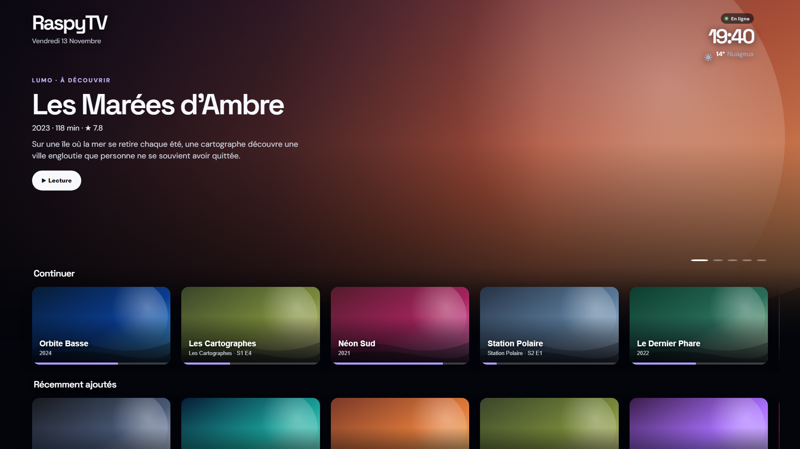
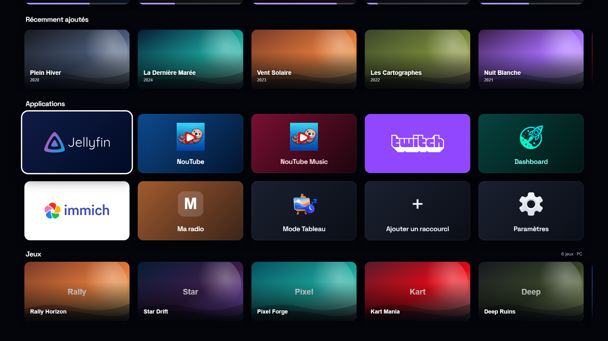
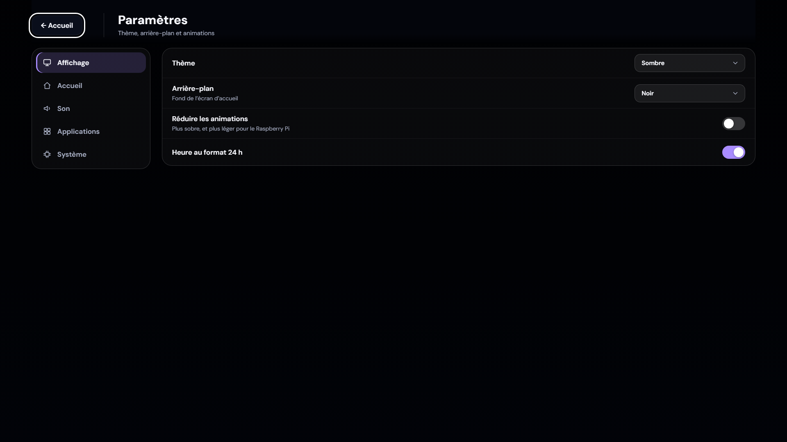
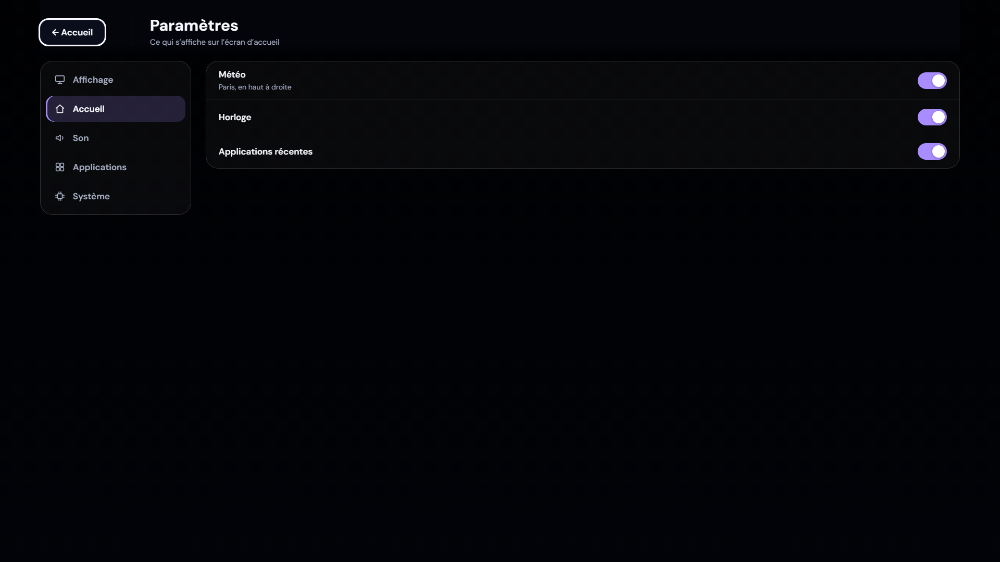
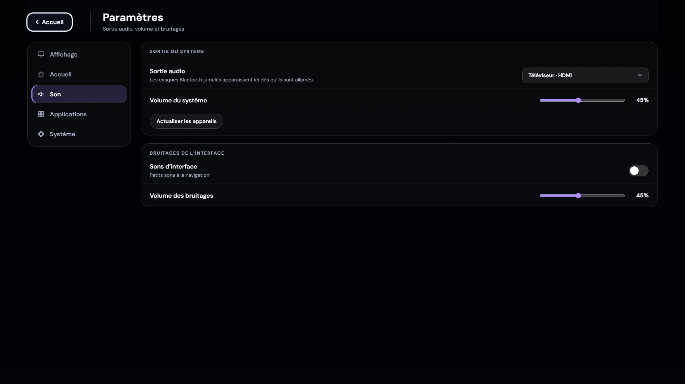
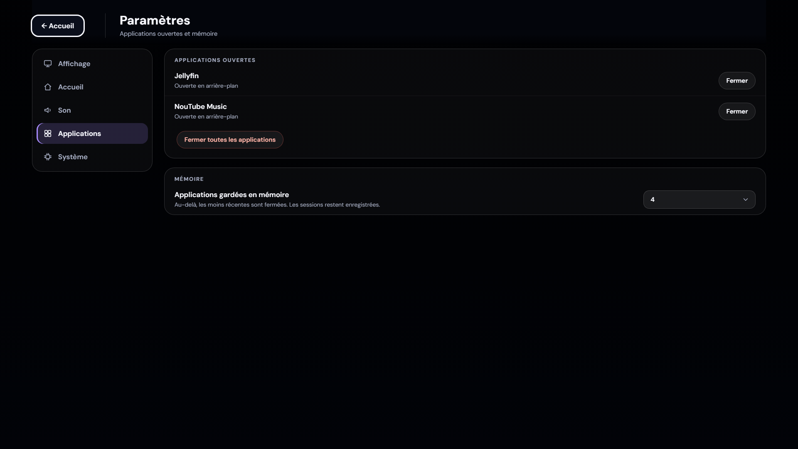
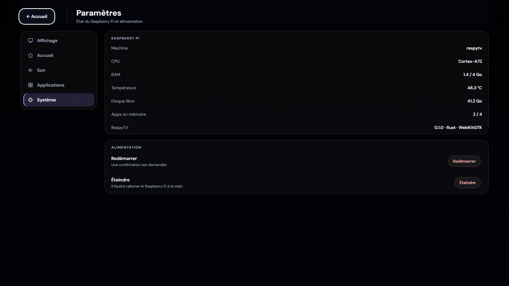
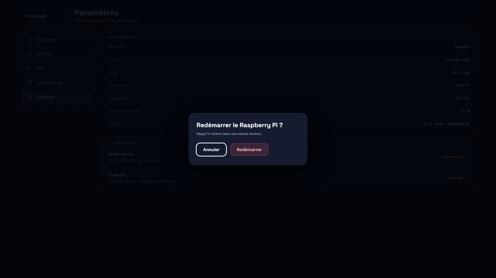

# RaspyTV, version Rust

Réécriture en Rust de [RaspyTV](https://github.com/0x80070006/RaspyTV), l'interface Smart TV en kiosque pour Raspberry Pi 4 (Raspberry Pi OS, labwc, Wayland). Les fonctionnalités et l'ergonomie restent les mêmes : accueil cinéma Jellyfin, applications persistantes, NouTube, jeux Moonlight, barre latérale et panneau de la manette au-dessus de tout, paramètres en onglets et mode Tableau. Le moteur web ne sert plus qu'à afficher les sites des services. Tout le reste est écrit en Rust, l'accueil compris : il est compilé en WebAssembly.



> Les captures viennent de la démonstration (`web/index.html` ouvert dans un navigateur), avec des données fictives : films, jeux et images sont générés.

## Sommaire

- [Fonctionnalités](#fonctionnalités)
- [Visite guidée](#visite-guidée)
- [Architecture](#architecture)
- [Ce qui n'est pas en Rust pur](#ce-qui-nest-pas-en-rust-pur)
- [Compilation](#compilation)
- [Installation sur le Raspberry Pi](#installation-sur-le-raspberry-pi)
- [Configuration](#configuration)
- [Commandes](#commandes)
- [État des tests](#état-des-tests)
- [Licences](#licences)

## Fonctionnalités

- **Accueil cinéma.** Chaque jour, le bandeau tire au sort 7 films Jellyfin, sans reprendre ceux de la veille quand la médiathèque le permet. Il défile toutes les 8 s et propose la lecture directe. Viennent ensuite les rangées « Continuer », avec la progression, et « Récemment ajoutés » (les 20 derniers films).
- **Session Jellyfin conservée.** Le jeton est relu dans Jellyfin Web, vérifié auprès du serveur puis stocké chiffré (ChaCha20-Poly1305). Il est réinstallé avant chaque ouverture de Jellyfin. Les images de l'accueil passent par un proxy interne, si bien que la page ne voit jamais le jeton.
- **Applications persistantes.** Jellyfin, NouTube, NouTube Music, Twitch, le tableau de bord et Immich s'ouvrent chacun dans leur vue web, avec leur propre dossier de données. Au-delà d'une limite réglable (2 à 6), les moins récentes sont fermées. NouTube Music n'est jamais fermée et continue de jouer en arrière-plan.
- **NouTube.** YouTube et YouTube Music sans publicité, avec les Shorts masqués et SponsorBlock. Il est possible d'importer une session Google exportée au format `cookies.txt`.
- **Lecture depuis l'accueil.** Le shell ouvre `#/details?id=…` puis appuie sur Lecture. `Échap` ferme d'abord le lecteur, puis revient à l'accueil.
- **Jeux Moonlight.** La rangée « Jeux » vient de `moonlight-qt list --csv`. Le flux se lance dans `moonlight-qt`, maximisé sans décoration grâce à une règle labwc écrite une seule fois, avec sauvegarde.
- **Barre latérale, OSD du volume, panneau PS et clavier virtuel**, en GTK layer-shell, au-dessus de tout, Moonlight compris.
- **Son.** Sorties `pactl`, déplacement des flux en cours, casques Bluetooth jumelés proposés pour s'y connecter, suivi en direct avec `pactl subscribe`.
- **Paramètres en onglets.** Affichage, Accueil, Son, Applications et Système. Tout se règle à la croix directionnelle.
- **Alimentation sécurisée.** Redémarrer et Éteindre passent par `sudo -n systemctl`, toujours après une confirmation où le focus est sur « Annuler ».
- **Mode Tableau.** Diaporama plein écran de vos images.
- **Manette.** gilrs gère la croix, ✕ et ○. Les boutons PS, Share et Options restent à [TelecomHand](https://github.com/0x80070006/TelecomHand), qui passe par le socket de commande, au même format qu'avant.
- **Robustesse.** Boucle kiosque `raspytv-kiosk` et service systemd qui relancent l'interface après un plantage. Un arrêt propre (code 0) termine la boucle. Le journal est tourné à 2 Mo.

## Visite guidée

### Applications et jeux



### Paramètres

| Affichage | Accueil |
| --- | --- |
|  |  |
| **Son** | **Applications** |
|  |  |
| **Système** | **Confirmation** |
|  |  |

La barre latérale, l'OSD du volume, le panneau PS et le clavier sont des surfaces GTK layer-shell. On ne peut donc les voir que sur le Pi, et elles n'apparaissent pas ici. Leur présentation reprend celle de la version Electron, voir le [README de RaspyTV](https://github.com/0x80070006/RaspyTV#barre-latérale).

## Architecture

```
crates/
  core/    raspytv-core : bibliothèque Rust pure, testée (aucune dépendance au moteur web ni à GTK)
  ui/      raspytv-ui   : accueil et paramètres, compilés en WebAssembly (wasm-bindgen + web-sys)
  shell/   raspytv      : fenêtre kiosque (tao + wry), vues des services, IPC, surfaces GTK
           raspytv-kiosk: boucle de relance après plantage
web/       page d'accueil, CSS d'origine, polices, icônes, scripts injectés dans les sites
packaging/ service systemd, autostart labwc, image Docker de compilation croisée
scripts/   compilation de l'accueil, paquet pour le Pi, installation
```

| Version Electron | Version Rust |
| --- | --- |
| `main.js` (processus principal) | `shell/src/app.rs`, `rpc.rs`, `background.rs` |
| `BrowserWindow` + `WebContentsView` | `tao` + `wry` (WebKitGTK sur le Pi, WebView2 sous Windows). Une `gtk::Stack` sous Wayland (`host.rs`) |
| Partitions `persist:raspy-tv-*` | Un `WebContext` par service : `~/.config/raspytv-rs/web/<service>` |
| `renderer.js`, `gallery.js` | `ui/src/render.rs` (HTML, fonctions pures) et `ui/src/app.rs` (événements, navigation spatiale, bandeau, mode Tableau, sons) |
| `preload.js` (`window.raspy`) | `window.ipc.postMessage` → `shell/src/rpc.rs`, réponses vers `window.__raspyHome.receive` |
| `layer-nav.py` (GTK3 Python) | `shell/src/layer.rs` (gtk-rs + `gtk-layer-shell`), dans le même processus |
| `keyboard.html` / `keyboard.js` | Clavier AZERTY en GTK layer-shell (`layer.rs`) |
| `moonlight-kiosk-setup.py` | `core/src/moonlight.rs` (`Moonlight.conf`, `rc.xml` vérifié avec roxmltree, `labwc --reconfigure`) |
| `safeStorage` | `core/src/vault.rs` (ChaCha20-Poly1305, clé `vault.key` en 0600 liée au `machine-id`) |
| `cookie-import.js` | `core/src/cookies.rs` + `WebView::set_cookie` |
| `start-kiosk.sh` | `raspytv-kiosk` |
| `demo.html` + `demo/mock-raspy.js` | `web/index.html` hors de RaspyTV : `ui/src/mock.rs` répond à la place du shell |

Le shell n'a qu'un fil d'interface : la boucle tao, qui est aussi la boucle GTK sur Linux. Les appels lents (Jellyfin, `pactl`, `bluetoothctl`, Moonlight, météo) tournent dans des fils de fond. Leur résultat revient sur le fil principal sous la forme d'un `UserEvent::Run`.

Pour cohabiter avec la version Electron, la version Rust a son propre dossier (`~/.config/raspytv-rs/`). Elle relit `~/.config/raspy-tv/site.json` si elle n'a pas encore le sien. Elle n'occupe pas `raspytv-nav.sock` si la version Electron l'écoute déjà : dans ce cas, elle prend `raspytv-rs-nav.sock`.

## Ce qui n'est pas en Rust pur

- **Les scripts injectés dans les sites tiers** restent en JavaScript : `web/inject/tv-input-adapter.js` (navigation à la croix dans les pages), le script NouTube (AGPL-3.0), la sonde « lecture en cours » et les commandes média. Ils s'exécutent dans YouTube, Jellyfin Web et les autres sites, dont la politique de sécurité interdit le WebAssembly. Le shell les génère depuis Rust (`core/src/media.rs`).
- **Le moteur web** (WebKitGTK) reste indispensable pour afficher les services.
- **Netflix et Spotify** ont besoin de Widevine, que WebKitGTK ne fournit pas sur le Pi. Ils ne figurent donc pas parmi les applications natives, comme dans la version Electron actuelle.
- **Connexion Google dans WebKitGTK** : Google peut refuser la connexion dans un navigateur intégré, même avec un user-agent Chrome. L'import `cookies.txt` reste prévu pour ce cas (`~/.config/raspytv-rs/import/youtube-cookies.txt`, effacé après import).
- **Saisie du clavier virtuel** : le texte est inséré dans le champ actif par `execCommand('insertText')`, et les touches spéciales sont simulées en JavaScript. Les rares sites qui exigent de vrais événements clavier (événements « trusted ») peuvent l'ignorer. Pendant Moonlight, c'est squeekboard qui sert de clavier, comme avant.

## Compilation

### Sous Windows (développement)

```bash
rustup target add wasm32-unknown-unknown
cargo install wasm-bindgen-cli --version 0.2.130
sh scripts/build-ui.sh            # ou scripts/build-ui.ps1 : compile l'accueil vers web/pkg
cargo run -p raspytv -- --windowed
```

Sous Windows, la barre latérale, le panneau, `pactl` et Moonlight sont absents : ils sont propres à Linux et protégés par `cfg`. L'accueil et les services fonctionnent avec WebView2. `RASPYTV_DATA_DIR` choisit un autre dossier de données, et `RASPYTV_SELFTEST=twitch` ouvre un service, revient à l'accueil puis quitte.

Démonstration seule, sans le shell : servez `web/` (par exemple `python -m http.server -d web`), puis ouvrez `index.html`, `index.html?page=settings&tab=sound` ou `index.html?section=apps`.

### Pour le Raspberry Pi (aarch64)

La compilation croisée passe par Docker, avec une image Debian 13 « trixie », comme le Pi :

```bash
sh scripts/package.sh             # accueil WASM + clippy + build aarch64 + archive dist/raspytv-rs-aarch64.tar.gz
```

### Vérifications

```bash
cargo test --workspace
cargo clippy --workspace --all-targets -- -D warnings
cargo clippy -p raspytv-ui --target wasm32-unknown-unknown -- -D warnings
```

## Installation sur le Raspberry Pi

Téléchargez `raspytv-rs-aarch64.tar.gz` depuis les [releases](https://github.com/0x80070006/RaspyTV-remake-rust/releases) (ou produisez-le avec `scripts/package.sh`), copiez-le sur le Pi, décompressez-le, puis lancez `raspytv-rs/install.sh`. Le script :

- installe `libwebkit2gtk-4.1-0` (et vérifie `libgtk-layer-shell0`, `pulseaudio-utils`, `bluez`, `playerctl`) ;
- copie les binaires et `web/` dans `~/.local/share/raspytv-rs/` ;
- crée `~/.config/raspytv-rs/site.json`, en reprenant celui de la version Electron s'il existe ;
- installe le service utilisateur `raspytv-rs.service` **sans l'activer**.

Pour l'essayer, arrêtez d'abord la version Electron (`systemctl --user stop raspytv`), puis lancez `systemctl --user start raspytv-rs`. Pour en faire l'interface par défaut, sauvegardez `~/.config/labwc/autostart`, puis remplacez-le par `packaging/labwc-autostart`. Celui-ci lance `raspytv-rs.service` ; en secours, il passe par la boucle `raspytv-kiosk`, puis par la version Electron si elle est encore installée.

Redémarrer et Éteindre demandent une règle sudo explicite, par exemple dans `/etc/sudoers.d/raspytv` :

```
<utilisateur> ALL=(root) NOPASSWD: /usr/bin/systemctl reboot, /usr/bin/systemctl poweroff
```

## Configuration

`~/.config/raspytv-rs/site.json` (modèle : [`site.example.json`](site.example.json)) :

| Clé | Rôle |
| --- | --- |
| `jellyfinUrl` | Serveur Jellyfin (accueil, « Continuer », lecture). |
| `jellyfinExtraHosts` | Autres noms du même serveur (facultatif). |
| `moonlightHost` | Adresse du PC de jeu ; vide pour masquer les jeux. |
| `dashboardUrl`, `immichUrl` | Tuiles facultatives ; une URL vide masque la tuile. |
| `weatherLatitude`, `weatherLongitude`, `weatherLabel`, `timezone` | Météo Open-Meteo, ville affichée, fuseau du tirage quotidien. |

Le même dossier contient aussi `config.json` (réglages de l'interface et raccourcis), `jellyfin-session.bin` (chiffré), `logs/raspy-tv.log`, `web/<service>/` (données des sites), `art/` (images du mode Tableau) et `backgrounds/` (fonds personnels `.mp4` / `.png`).

## Commandes

| Touche | Action |
| --- | --- |
| Flèches, `Entrée` | Navigation et validation (croix et ✕ de la manette aussi) |
| `Échap` | Retour, fermeture d'une fenêtre (○ de la manette aussi) |
| `Début` ou `Ctrl+Alt+H` | Accueil |
| `Ctrl+Alt+Maj+Q` | Quitter RaspyTV |

Socket de commande `$XDG_RUNTIME_DIR/raspytv-nav.sock` : une commande JSON par connexion, au même format que la version Electron, par exemple `{"action":"tv-home"}`, `{"action":"launch","id":"twitch"}` ou `{"action":"volume","delta":5}`. Les actions reconnues sont `home`, `settings`, `launch`, `moonlight`, `moonlight-game`, `keyboard`, `volume`, `volume-set`, `audio-output`, `media`, `system-power`, `nav-peek`, `tv-home`, `tv-settings`, `tv-back`, `tv-play-pause`, `tv-context`, `tv-nav-peek`, `tv-panel`, `tv-panel-state`, `tv-state` et `noutube-import-session`. Le fichier `raspytv-panel.open` existe tant que le panneau est ouvert, et `nav-state.json` décrit l'état de la barre.

## État des tests

Essais du 16 novembre 2026 sur le Raspberry Pi 4 (Raspberry Pi OS 13, labwc, WebKitGTK 2.54), à la place du kiosque Electron :

| Élément | Windows | Raspberry Pi |
| --- | --- | --- |
| `raspytv-core` et `raspytv-ui` (43 tests unitaires) | ✅ | — |
| Compilation croisée aarch64 + clippy du code Linux | ✅ (Docker) | ✅ binaire lancé |
| Accueil : bandeau, « Continuer », « Récemment ajoutés », images via le proxy | ✅ (démo) | ✅ |
| Session Jellyfin reprise de la version Electron, chiffrée, restaurée dans Jellyfin Web | — | ✅ |
| Lecture depuis l'accueil, `Échap` (lecteur puis accueil) | — | ✅ 1080p H.264, ~24 i/s, aucune image perdue |
| Barre latérale (Share), tiroir Apps, navigation au clavier | — | ✅ |
| Panneau PS : volume, sorties audio (Bluetooth compris), alimentation avec « Annuler » | — | ✅ |
| OSD du volume, `pactl` | — | ✅ |
| NouTube actif dans YouTube (Shorts masqués) | — | ✅ (connexion Google à refaire) |
| Clavier virtuel : affichage sur un champ | — | ✅ (saisie non testée à distance) |
| Mode Tableau, paramètres (Son), jeux Moonlight et jaquettes | — | ✅ |
| Moonlight ouvert, barre au-dessus, retour à l'accueil | — | ✅ (flux de jeu non lancé) |
| Twitch, Immich, Dashboard, squeekboard, redémarrage / extinction | ✅ Twitch (WebView2) | non testé |

Réglages appliqués par défaut sous Linux, mesurés sur le Pi (une variable déjà définie l'emporte) :

- `WEBKIT_DMABUF_RENDERER_FORCE_SHM=1` : les tampons GBM du rendu DMA-BUF donnent une image brouillée sur le GPU V3D. Désactiver complètement ce rendu limite la vidéo à ~4 images/s.
- `GST_PLUGIN_FEATURE_RANK=v4l2h264dec:MAX,v4l2slh265dec:MAX` : décodage matériel H.264 / HEVC.

Débogage : `RASPYTV_DEBUG=1` journalise les pages chargées et accepte sur le socket `{"action":"debug-eval","id":"home|<service>","js":"…"}` (résultat dans le journal). `RASPYTV_NOUTUBE_UA=webkit` garde le user-agent de WebKitGTK pour NouTube.

## Licences

- `web/inject/noutube/noutube-content.js` vient de [NouTube](https://github.com/nonbili/NouTube) et reste sous licence **AGPL-3.0** (voir `web/inject/noutube/LICENSE`).
- Les polices DM Sans et Space Grotesk sont sous licence SIL Open Font.
- Les logos des services appartiennent à leurs propriétaires et servent uniquement à identifier les tuiles. Les logos complets viennent de Wikimedia Commons et des dépôts officiels de Jellyfin (CC BY-SA 4.0) et d'Immich.
- Le reste du code est sous licence **MIT** (voir [`LICENSE`](LICENSE)), comme RaspyTV.
